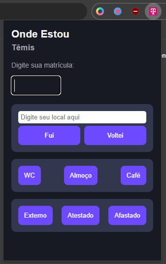

# Têmis — Extensão para Navegador

Extensão desenvolvida para complementar o uso painel **Onde Estou**, permitindo que o colaborador atualize sua localização sem ter a necessidade de abrir o painel.

## Funcionalidades

- **Atualização de localização:** permite atualizar a localização diretamente pela extensão.
- **Acesso facilitado:** disponibiliza as principais ações em um painel acessível pelo navegador.
- **Integração com o sistema interno:** utiliza o painel Onde Estou como referência para o processo de atualização.

## Público-alvo

Esta extensão é destinada exclusivamente ao **uso interno da empresa** e não se destina ao uso público.

## Localização dos arquivos

Os arquivos de instalação estão disponíveis na rede interna da empresa.

É necessário ter acesso à unidade de rede para localizar os arquivos.

## Instalação no Google Chrome

1. Acesse o caminho da rede interna.
2. Localize a pasta da extensão.
3. Abra o Google Chrome e acesse `chrome://extensions`.
4. Ative o **Modo do desenvolvedor**.
5. Clique em **Carregar sem compactação**.
6. Selecione a pasta que contém o arquivo `manifest.json`.

Após a instalação, a extensão ficará disponível no navegador. Recomenda-se fixá-la na barra de ferramentas para facilitar o acesso.

## Instalação no Mozilla Firefox

### Carregamento temporário para teste

1. Acesse o caminho da rede interna.
2. Localize a pasta com os arquivos-fonte da extensão, contendo o `manifest.json`.
3. Abra o Mozilla Firefox.
4. Digite `about:debugging` na barra de endereços.
5. Selecione **Este Firefox** (*This Firefox*).
6. Clique em **Carregar extensão temporária** (*Load Temporary Add-on*).
7. Navegue até a pasta da extensão e selecione o arquivo `manifest.json`.

A extensão será carregada temporariamente para testes.

**Importante:** extensões carregadas dessa maneira deixam de estar instaladas quando o Firefox é reiniciado. Para disponibilizar a extensão de forma permanente, é necessário preparar um pacote compatível com o Firefox e atender aos requisitos de assinatura ou às políticas corporativas aplicáveis.

## Licença e distribuição

Projeto destinado ao uso interno da empresa. A distribuição, modificação e utilização devem seguir as diretrizes internas aplicáveis.